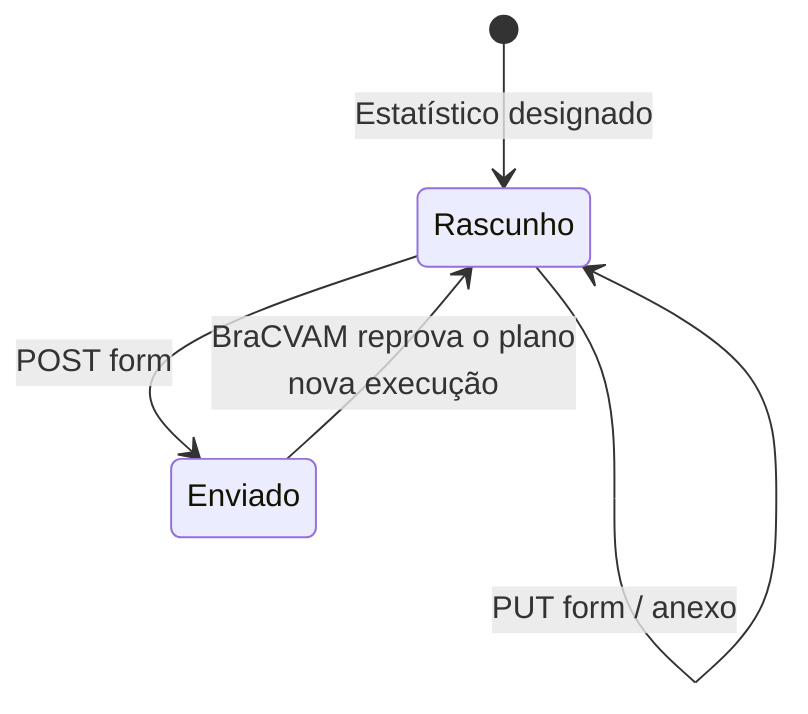

# Enviar o plano estatístico

Quando o Grupo Gestor designa o Estatístico, ele recebe a tarefa
`statistical_plan`. O plano é um dos pontos que o BraCVAM confere na
homologação da estrutura. A rota base do formulário é:

```bash
FORM=$API/processes/$PID/activities/statistical_plan/form
```



## Campos

| Campo | Tipo | Obrigatório |
|---|---|---|
| `plan_file` | Anexo, PDF ou DOCX | Sim |
| `summary` | Texto longo | Não |

Só o cargo `statistician` edita o formulário. Admin e BraCVAM o leem.

## 1. Anexar o plano

```bash
curl -s -X POST $FORM/fields/plan_file/attachment -H "Authorization: Bearer $TOKEN" \
  -F file=@plano.pdf
```

Um anexo novo substitui o anterior enquanto o formulário não foi enviado.
Os limites de extensão e tamanho são os mesmos dos anexos da proposta
([Enviar uma proposta](enviar-uma-proposta.md)).

## 2. Enviar

```bash
curl -s -X POST $FORM -H "Authorization: Bearer $TOKEN" \
  -H 'Content-Type: application/json' \
  -d '{"values":{"summary":"Análise de concordância entre laboratórios."}}'
```

A resposta traz `status` `COMPLETED`, `artifact_id` `null` e
`pre_evaluation` `null`. O envio grava `FORM_SUBMITTED` na linha do tempo. O
plano não gera Dossiê de Submissão, não passa por pré-avaliação por IA e não
mexe na triagem.

| Erro | Quando |
|---|---|
| `422 invalid_form_values` | Sem o anexo (`field: values.plan_file`, `code: attachment_required`) |
| `409 invalid_transition` | Formulário já enviado |
| `403 forbidden` | Quem chama vê a atividade sem o cargo `statistician` |
| `404 not_found` | Quem chama não vê a atividade |

## Quando o BraCVAM reprova o plano

A reprovação abre uma execução nova da tarefa, com o motivo, e um formulário
em branco. O formulário anterior continua enviado, com o anexo, na execução
anterior. O BraCVAM pode consultar o formulário e baixar o anexo da execução
anterior informando seu número nas rotas GET:

```bash
curl -s "$FORM?run_number=1" -H "Authorization: Bearer $TOKEN"
curl -s "$FORM/fields/plan_file/attachment?run_number=1" \
  -H "Authorization: Bearer $TOKEN" -o plano-anterior.pdf
```

Sem `run_number`, essas rotas continuam mostrando a execução mais recente.
Rotas de escrita só operam na execução atual. Leia o motivo no
`ACTIVITY_REOPENED` da linha do tempo, anexe o plano revisado e envie de novo.
Veja
[Quando o BraCVAM reprova a estrutura](../tutorial/homologacao-da-estrutura.md).
