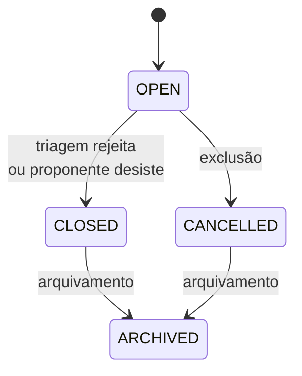
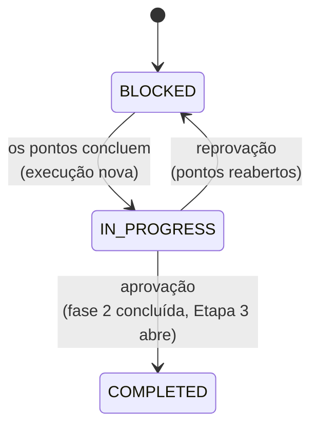
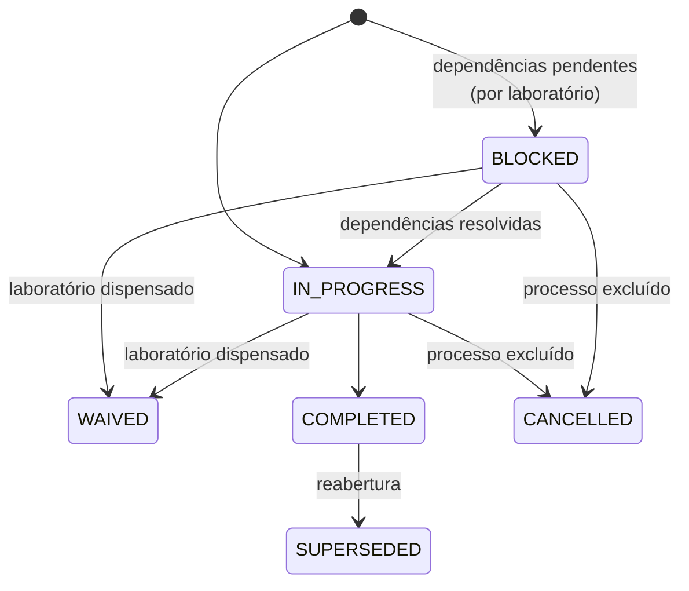
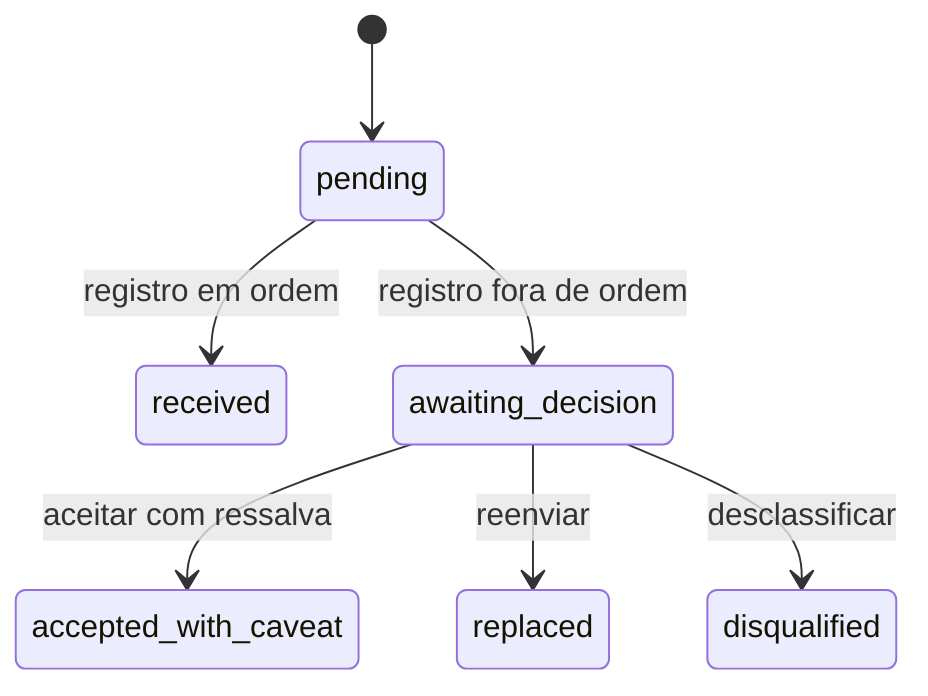

# Estados

## Processo (`status`)

Guarda só o ciclo de vida. A posição no fluxo vem das fases e atividades.

| Valor | Significado | Muda por |
|---|---|---|
| `OPEN` | Em andamento | Criação |
| `CLOSED` | Encerrado | `REJECTED` na triagem; `WITHDRAW` na revisão do retorno |
| `CANCELLED` | Excluído logicamente | `DELETE /processes/{id}` (proponente ou Admin/BraCVAM) |
| `ARCHIVED` | Arquivado | `PATCH /processes/{id}/archive` (`triage.review`) |

Um `CHECK` no banco aceita só esses quatro valores. `CLOSED`, `CANCELLED` e
`ARCHIVED` não aceitam mutações (`409`).

## Fase

| Valor | Significado |
|---|---|
| `NOT_STARTED` | Nenhuma atividade aberta ainda |
| `IN_PROGRESS` | Alguma atividade aberta |
| `COMPLETED` | Fase concluída |
| `CANCELLED` | Cancelada pela exclusão do processo |

## Atividade

| Valor | Significado |
|---|---|
| `BLOCKED` | Esperando dependências |
| `IN_PROGRESS` | Aberta; pode haver várias ao mesmo tempo no processo |
| `COMPLETED` | Concluída |
| `CANCELLED` | Cancelada pela exclusão do processo |

### Homologação da estrutura

A atividade `structure_approval` fecha a Etapa 2. Ela volta a `BLOCKED`
quando o BraCVAM reprova pontos, com `blocked_reason` "Aguardando a
reexecução dos pontos reprovados.".

Um ponto reprovado volta de `COMPLETED` para `IN_PROGRESS` com uma execução
nova. A execução anterior continua `COMPLETED`. Cada ponto volta a
`COMPLETED` assim:

| Ponto | Conclui quando |
|---|---|
| Atribuição de cargo | Quem gere o cargo declara que terminou, com ao menos uma designação ativa e nenhum convite pendente. Designar e revogar não fecham a execução reaberta |
| Plano estatístico | O Estatístico envia o formulário novo com o anexo |
| Definição das amostras | O Grupo de Seleção conclui as amostras de novo |

## Execução de atividade

Cada atividade tem uma ou mais execuções (`run_number`). Uma revisão do
retorno, uma reabertura ou a reprovação de um ponto na homologação cria a
execução seguinte.

| Valor | Significado |
|---|---|
| `IN_PROGRESS` | Aberta, com tarefa |
| `BLOCKED` | Execução de laboratório esperando a anterior do mesmo laboratório; sem tarefa |
| `COMPLETED` | Concluída |
| `CANCELLED` | Cancelada |
| `WAIVED` | Laboratório dispensado pelo gestor |
| `SUPERSEDED` | Substituída por uma reabertura; dados preservados |

## Frasco no recebimento

A situação de cada frasco vem do registro do laboratório e da decisão do
Grupo de Seleção de Amostras. Ela não é gravada; a API a calcula.

| Valor | Significado |
|---|---|
| `pending` | Sem registro |
| `received` | Registrado em ordem |
| `awaiting_decision` | Fora de ordem, com inconformidade aberta |
| `accepted_with_caveat` | Aceito com ressalva; conta como recebido |
| `replaced` | Substituído por um frasco com código novo |
| `disqualified` | Laboratório desclassificado na fase |

O recebimento do laboratório conclui quando todo frasco ativo dele está
`received` ou `accepted_with_caveat`.

## Inconformidade do recebimento

| Valor | Significado |
|---|---|
| `OPEN` | Esperando a decisão do Grupo de Seleção |
| `RESOLVED` | Decidida: `accept_with_caveat`, `resend` ou `disqualify` |

## Tarefa

| Valor | Significado |
|---|---|
| `READY` | Aberta, para o cargo da atividade |
| `COMPLETED` | Concluída |
| `CANCELLED` | Cancelada |

## Convite

| Valor | Significado |
|---|---|
| `pending` | Esperando aceite |
| `accepted` | Aceito; virou designação |
| `revoked` | Revogado |

Convite pendente com prazo vencido responde `409 invite_expired`.

## Envio de notificação

| Valor | Significado |
|---|---|
| `pending` | Na fila do worker |
| `sent` | Aceito pelo servidor SMTP |
| `failed` | Falhou; ver `error_code` |
| `cancelled` | Cancelado (convite aceito ou revogado, novo pedido de senha) |

`error_code`: `smtp_permanent`, `smtp_temporary`, `connection`,
`max_attempts`, `expired`, `decrypt`, `cancelled_*`.

## Pré-avaliação por IA

| Execução | Resultado consolidado |
|---|---|
| `in_progress`, `completed`, `failed`, `CANCELLED` (processo excluído) | `positive`, `negative` |

Conclusão de cada critério: `compliant`, `non_compliant`, `partial`,
`indeterminate`.
