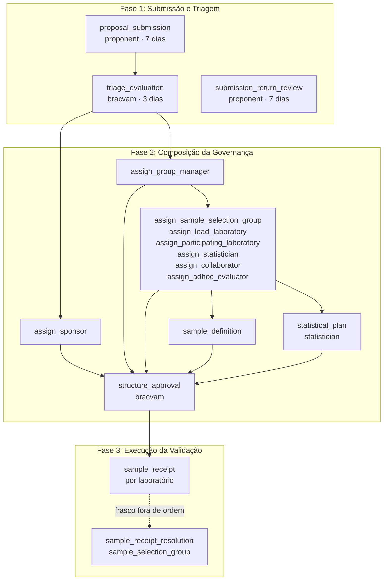

# Templates de processo

Quatro templates vêm com o sistema, em `src/pivma/templates_data/`, e são
carregados pelo provisionamento. Cada template é um tipo de submissão. Um
processo usa a versão publicada mais recente do template na criação e fica
nela até o fim.

`GET /processes/templates` lista os tipos pela `display_order` declarada em
cada YAML, nesta ordem:

| Ordem | `key` | Nome | Versão | Formulário de submissão |
|---|---|---|---|---|
| 1 | `pre_validated_method` | Método Novo | 5 | `submission_pre_validated_v1` (1 campo) |
| 2 | `validated_method_dossier` | Método Novo – Dossiê Completo | 7 | `submission_validated_dossier_v1` (2 campos) |
| 3 | `scope_extension` | Extensão do Domínio de Aplicação | 5 | `submission_scope_extension_v1` (1 campo) |
| 4 | `me_too_validation` | Método Similar | 5 | `submission_me_too_v1` (1 campo) |

Cada formulário de submissão se chama "Formulário de Submissão - <nome do
tipo>". Um template sem `display_order`, criado direto no banco, aparece
depois dos quatro.

Os quatro têm as mesmas fases e atividades. Muda o formulário de submissão;
todos trazem também o formulário `statistical_plan_v1`, do plano
estatístico. Os processos criados com a versão anterior de cada template não
têm a homologação da estrutura nem o plano estatístico: neles, o
recebimento abre quando as amostras concluem.

## Fases e atividades

| Atividade | Fase | Tipo | Edita | Depende de | Prazo |
|---|---|---|---|---|---|
| `proposal_submission` | 1 | `form` | `proponent` | — | 168 h |
| `triage_evaluation` | 1 | `form` (sem formulário; decisão própria) | `bracvam` | `proposal_submission` | 72 h |
| `submission_return_review` | 1 | `return_review` | `proponent` | aberta pela IA ou pela triagem | 168 h |
| `assign_sponsor` | 2 | `role_assignment` | `proponent` | `triage_evaluation` | — |
| `assign_group_manager` | 2 | `role_assignment` | `proponent` | `triage_evaluation` | — |
| `assign_sample_selection_group` | 2 | `role_assignment` | `group_manager` | `assign_group_manager` | — |
| `assign_lead_laboratory` | 2 | `role_assignment` | `group_manager` | `assign_group_manager` | — |
| `assign_participating_laboratory` | 2 | `role_assignment` | `group_manager` | `assign_group_manager` | — |
| `assign_statistician` | 2 | `role_assignment` | `group_manager` | `assign_group_manager` | — |
| `assign_collaborator` | 2 | `role_assignment` | `bracvam` | `assign_group_manager` | — |
| `assign_adhoc_evaluator` | 2 | `role_assignment` | `bracvam` | `assign_group_manager` | — |
| `sample_definition` | 2 | `sample_definition` | `sample_selection_group` | `assign_sample_selection_group` e `assign_participating_laboratory` | — |
| `statistical_plan` | 2 | `form` (`statistical_plan_v1`) | `statistician` | `assign_statistician` | — |
| `structure_approval` | 2 | `structure_approval` | `bracvam` | as dez atividades acima da fase 2 | — |
| `sample_receipt` | 3 | `sample_receipt`, por laboratório | `participating_laboratory` | `structure_approval` | — |
| `sample_receipt_resolution` | 3 | `sample_receipt_resolution` | `sample_selection_group` | aberta quando um laboratório registra um frasco fora de ordem | — |

Nenhuma atividade dos templates lista cargos em `view`: cada atividade é vista
pelos cargos que a editam, por Admin e por BraCVAM.

`sample_receipt` é a única atividade executada por laboratório: cada
laboratório congelado em `sample_definition` ganha a própria execução. Veja
[Isolamento por laboratório](../explicacao/isolamento-por-laboratorio.md) e
[Receber amostras](../guias/receber-amostras.md).

## Consultar pela API

| Rota | Conteúdo |
|---|---|
| `GET /processes/templates` | Templates ativos, por `display_order` |
| `GET /processes/templates/{key}` | Definição da versão: fases, atividades, formulários |
| `GET /processes/templates/{key}/forms/{form_key}` | Campos de um formulário |
