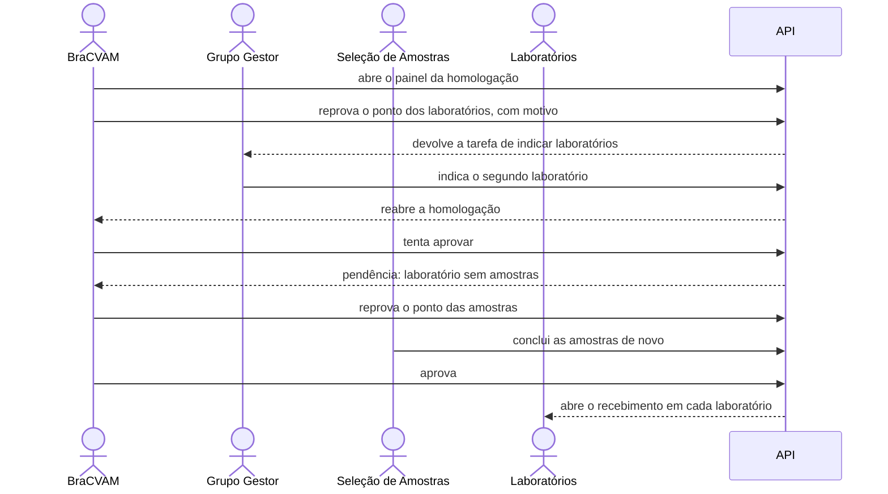

# Quando o BraCVAM reprova a estrutura

Antes de os laboratórios receberem as amostras, o BraCVAM confere a equipe e
as amostras do estudo. Neste tutorial o triador encontra um laboratório a
menos do que o protocolo prevê e reprova esse ponto. A gestora indica o
laboratório que faltava, a seleção de amostras gera os códigos dele, e o
triador aprova. A Etapa 3 abre para os dois laboratórios, e cada decisão
fica no histórico.



## Os personagens

- **Triador do BraCVAM**: confere a estrutura e decide. Vê quantas
  substâncias e códigos existem, nunca quais são.
- **Gestora do estudo**: corrige a equipe.
- **Seleção de Amostras**: refaz as amostras quando o BraCVAM pede.
- **Técnicos dos laboratórios**: esperam a aprovação para receber os frascos.

## Antes de começar

Faça o tutorial [Montar a equipe e preparar as amostras](equipe-e-amostras.md)
inteiro. Ele termina com os oito cargos designados e as amostras concluídas,
o que abre a homologação para o BraCVAM. Use o mesmo terminal: os comandos
abaixo reaproveitam as funções `login`, `signup` e `designar` e a variável
`$INST`.

??? example "Como fazer pela API"
    ```bash
    TRI=$(login triador senha-segura-123)
    GM=$(login gestora senha-segura-123)
    SEL=$(login selecao senha-segura-123)
    ADMIN=$(login admin@example.com admin-senha-123)
    PID=$(curl -s "$API/processes" -H "Authorization: Bearer $TRI" \
      | jq -r '.data[] | select(.title=="Método 3T3 NRU") | .id')
    decidir() {
      curl -s -X POST $API/processes/$PID/structure-approval/decision \
        -H "Authorization: Bearer $TRI" -H 'Content-Type: application/json' -d "$1"
    }
    ```

## 1. O triador abre o painel

O triador tem uma tarefa nova: a homologação da estrutura do estudo. O
painel lista os nove pontos da Etapa 2, as pessoas designadas em cada cargo
e as contagens das amostras. Nenhum ponto tem pendência.

??? example "Como fazer pela API"
    ```bash
    curl -s "$API/tasks?process_id=$PID&status=READY" -H "Authorization: Bearer $TRI" \
      | jq '.data[] | .activity_key'
    curl -s $API/processes/$PID/structure-approval -H "Authorization: Bearer $TRI" \
      | jq '{status, points: [.points[] | {activity_key, status, pending}]}'
    ```

    A tarefa é `structure_approval`, e o painel responde `IN_PROGRESS`.

## 2. O triador reprova o ponto dos laboratórios

O protocolo prevê dois laboratórios, e a equipe tem um. O triador reprova o
ponto "Definir os Laboratórios Participantes" e escreve o motivo. A
homologação fica bloqueada até a gestora corrigir.

??? example "Como fazer pela API"
    ```bash
    decidir '{"outcome":"REJECTED","justification":"Equipe incompleta.",
              "rejected_points":[{"activity_key":"assign_participating_laboratory",
                                  "reason":"O protocolo prevê dois laboratórios."}]}' | jq
    ```

    Resposta: `status` `BLOCKED` e o ponto reaberto na execução 2.

## 3. A gestora vê a tarefa de volta

A tarefa de indicar laboratórios volta para a gestora como uma execução
nova. A execução anterior continua concluída no histórico. A gestora lê o
motivo do triador na linha do tempo do processo.

??? example "Como fazer pela API"
    ```bash
    curl -s "$API/tasks?process_id=$PID&activity_key=assign_participating_laboratory&current_run=false" \
      -H "Authorization: Bearer $GM" | jq '.data[] | {activity_run_number, status}'
    curl -s "$API/processes/$PID/timeline?per_page=100" -H "Authorization: Bearer $GM" \
      | jq '.data[] | select(.event_type=="ACTIVITY_REOPENED") | .context_data.reason'
    ```

    A resposta é `"O protocolo prevê dois laboratórios."`. A gestora não vê
    a decisão do triador, só o motivo do ponto dela.

## 4. A gestora indica o segundo laboratório

O administrador cadastra o segundo laboratório e vincula a técnica dele. A
gestora indica a técnica como laboratório participante. A tarefa dela se
fecha, e a homologação volta para o triador.

??? example "Como fazer pela API"
    ```bash
    TECNICA_ID=$(signup tecnica)
    LAB2=$(curl -s -X POST $API/institutional/laboratories -H "Authorization: Bearer $ADMIN" \
      -H 'Content-Type: application/json' \
      -d "{\"institution_id\":\"$INST\",\"name\":\"Laboratório de Cultura Celular\"}" | jq -r .id)
    curl -s -X POST $API/institutional/users/$TECNICA_ID/affiliations -H "Authorization: Bearer $ADMIN" \
      -H 'Content-Type: application/json' \
      -d "{\"institution_id\":\"$INST\",\"laboratory_id\":\"$LAB2\"}" -o /dev/null -w '%{http_code}\n'
    designar $GM $TECNICA_ID participating_laboratory $LAB2
    ```

## 5. O painel aponta o laboratório sem amostras

O laboratório novo ainda não tem códigos cegos. O painel mostra a pendência
no ponto das amostras, e a aprovação é recusada.

??? example "Como fazer pela API"
    ```bash
    curl -s $API/processes/$PID/structure-approval -H "Authorization: Bearer $TRI" \
      | jq '.points[] | select(.activity_key=="sample_definition") | .pending'
    decidir '{"outcome":"APPROVED","justification":"Equipe conferida."}' | jq .detail.code
    ```

    A pendência é `laboratory_without_codes`, e a aprovação responde
    `structure_pending`.

## 6. O triador reprova as amostras e a seleção as refaz

O triador reprova o ponto das amostras. A seleção recebe a tarefa de novo e
conclui as amostras: o laboratório novo ganha os códigos dele, e os do
primeiro laboratório não mudam.

??? example "Como fazer pela API"
    ```bash
    decidir '{"outcome":"REJECTED","justification":"Faltam amostras.",
              "rejected_points":[{"activity_key":"sample_definition",
                                  "reason":"Gerar códigos para o laboratório novo."}]}' | jq .status
    curl -s -X POST $API/processes/$PID/samples/complete -H "Authorization: Bearer $SEL" \
      -o /dev/null -w '%{http_code}\n'
    ```

## 7. O triador aprova e a Etapa 3 abre

Sem pendências, o triador aprova com uma justificativa. Cada laboratório
recebe a tarefa de confirmar o recebimento dos próprios frascos.

??? example "Como fazer pela API"
    ```bash
    decidir '{"outcome":"APPROVED","justification":"Equipe e amostras conferidas."}' | jq
    TEC=$(login tecnico senha-segura-123)
    curl -s "$API/tasks?process_id=$PID&status=READY" -H "Authorization: Bearer $TEC" \
      | jq '.data[] | .activity_key'
    ```

    Resposta: `status` `COMPLETED`; o técnico vê `sample_receipt`.

## 8. O histórico fica no painel

O painel guarda as três decisões, da mais recente para a mais antiga, com
autor, data, justificativa e os pontos reprovados com os motivos.

??? example "Como fazer pela API"
    ```bash
    curl -s $API/processes/$PID/structure-approval -H "Authorization: Bearer $TRI" \
      | jq '.decisions[] | {run_number, outcome, rejected_points}'
    ```

## O que você viu

- A Etapa 3 só abre depois que o BraCVAM aprova a estrutura.
- Reprovar um ponto devolve a tarefa a quem o executa, com o motivo, e
  guarda a execução anterior.
- A homologação reabre sozinha quando o último ponto reprovado conclui.
- A aprovação confere a estrutura no momento da decisão: um laboratório sem
  amostras impede a aprovação.

Mais detalhes: [Modelo de processo](../explicacao/modelo-de-processo.md) e
[Rotas](../referencia/rotas.md). O próximo passo do estudo está em
[Quando um frasco chega com problema](recebimento-com-avaria.md).
