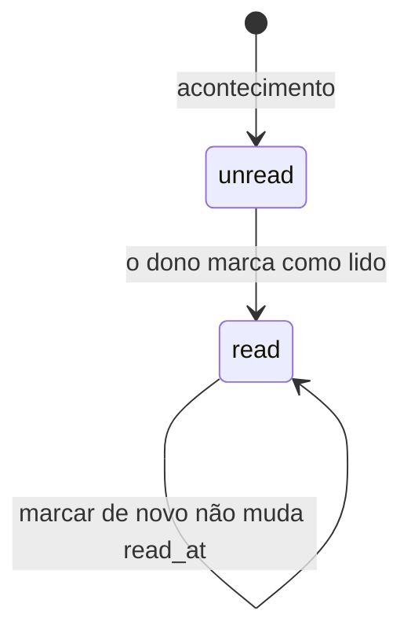

# Data Model: Alerts na plataforma

## Alert (`alerts`)

Herda `AuditMixin` (`created_at`, `created_by`, `updated_at`, `updated_by`, `deleted_at`, `deleted_by`).

| Campo | Tipo | Regra |
|---|---|---|
| `id` | UUID | Chave primária |
| `user_id` | UUID, FK `users.id` | Dono do alert. Obrigatório |
| `kind` | `String(64)` | Um dos tipos da tabela abaixo |
| `target_type` | `String(32)` | `process`, `task` ou `sample_receipt` |
| `process_instance_id` | UUID, FK `process_instances.id` | Processo de origem. Obrigatório |
| `target_id` | UUID, nulo | Tarefa (`task`) ou frasco (`sample_receipt`). Nulo em `process` |
| `params` | JSONB | Chaves fixas por tipo. Nunca nulo; `{}` quando o tipo não tem parâmetro além do processo |
| `read_at` | `datetime`, nulo | Nulo enquanto não lido. Só muda de nulo para uma data |

Índices:

- `ix_alerts_user_created`: `(user_id, created_at DESC)`.
- `ix_alerts_user_unread`: `(user_id)` `WHERE read_at IS NULL`.

Restrição de verificação: `target_type = 'process'` se, e somente se, `target_id` for nulo.

`created_by` é o autor da ação, ou nulo quando ela é automática (research R5). `updated_by` é o dono, quando ele marca o alert como lido. Não há exclusão nesta entrega.

### Estados

## Parâmetros por tipo

Todos os tipos trazem `process_code` e `process_title`, salvo onde a tabela indica outra coisa.

| Tipo | `target_type` | Parâmetros além do processo |
|---|---|---|
| `task_opened` | `task` | `activity_key`, `activity_name`, `run_number`, `due_date` (ISO 8601 ou nulo), `laboratory_name` (só em execução por laboratório) |
| `submission_status_changed` | `process` | `status`: `in_triage`, `approved` ou `rejected` |
| `structure_approved` | `process` | nenhum |
| `process_withdrawn` | `process` | nenhum |
| `assignment_created` | `process` | `role_key`, `laboratory_name` (nulo sem laboratório) |
| `assignment_revoked` | `process` | `role_key`, `laboratory_name` (nulo sem laboratório) |
| `assignment_effectiveness_changed` | `process` | `role_key`, `laboratory_name`, `effective` (booleano) |
| `laboratory_run_completed` | `process` | `activity_name`, `laboratory_name` |
| `laboratory_run_waived` | `process` | `phase_name`, `laboratory_name` |
| `sample_nonconformity_decided` | `sample_receipt` | `laboratory_name`, `blind_code`, `vial_status` |

Nenhum parâmetro guarda justificativa, parecer, resultado da IA, indicação de falha da IA, nome de pessoa, nome químico, CAS, SDS, orientação do Grupo ou código do frasco novo.

## Destinatários

| Tipo | Destinatários (conta ativa, sem o autor da ação) |
|---|---|
| `task_opened` | Quem passa em `task_can_act_clause` para a tarefa (research R3) |
| `submission_status_changed` | Designação `proponent` ativa no processo |
| `structure_approved` | Designação `proponent` ativa e demais designações ativas e efetivas no processo |
| `process_withdrawn` | Perfil `bracvam` ativo e designações ativas no processo fora `proponent` |
| `assignment_created`, `assignment_revoked`, `assignment_effectiveness_changed` | O usuário da designação |
| `laboratory_run_completed` | Designação ativa e efetiva `group_manager` ou `study_manager` no processo |
| `laboratory_run_waived`, `sample_nonconformity_decided` | Designação `participating_laboratory` ativa e efetiva pelo laboratório em questão |
